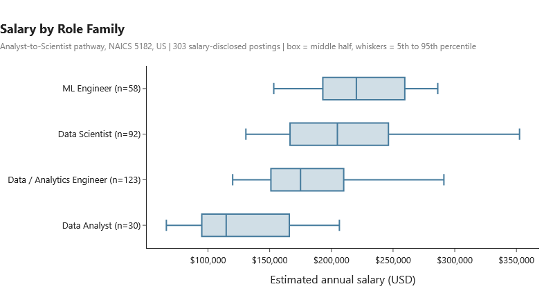
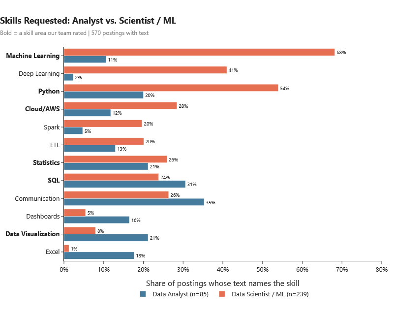
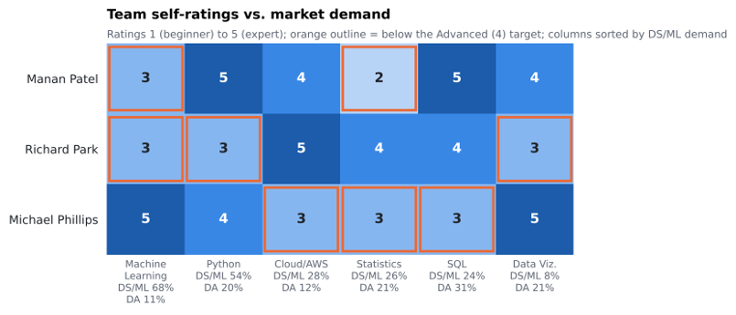
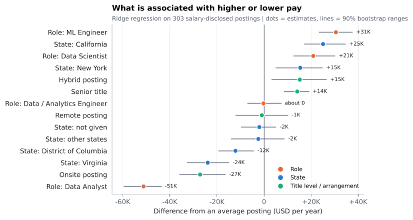
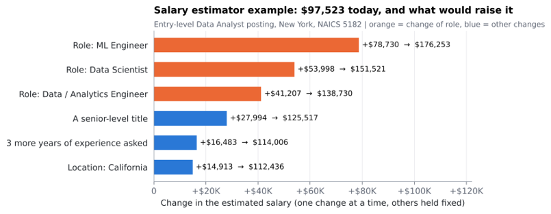
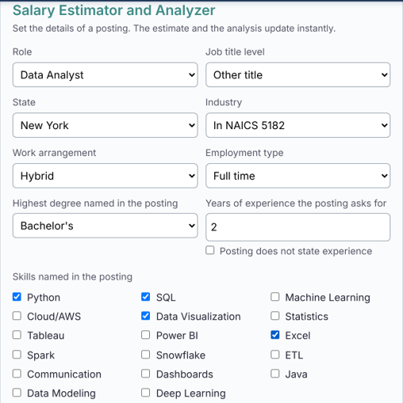

---
format:
  docx:
    reference-doc: report-reference.docx
---

<!-- Source of the team's final research paper. Render with:
     quarto render final_report.qmd --to docx
     python polish_docx.py _site/final_report.docx -->

::: {custom-style="Title Page"}
Boston University Metropolitan College

AD688: Big Data and Cloud Analytics for Business (Fall 2026)

 

Business Running Case: Evaluating Personal Job Market Prospects

Final Report

 

 

 

 

 

 

 

 

 

Submitted by:

Manan Patel, Richard Park, Michael Phillips

Group 6

October 11, 2026
:::



# Executive Summary

This report seeks to provide guidance and recommendations to students utilizing our services for the purposes of navigating through the
Computing Infrastructure Providers, Data Processing, Web Hosting, & Related Services (NAICS 5182) career industry. Data on career paths
listed under the umbrella of NAICS 5182 were analyzed and evaluated to develop a career evaluation product for job seekers targeting Data
Analyst roles, with a growth path toward Data Scientist, Analytics Engineer, and Machine Learning Engineer positions. Our end-user product
includes a public website with interactive charts and a salary estimator, built on MET Career Compass job files. After filtering through
815,193 postings to our industry and pathway and removing repeat listings, 765 postings still remained, 303 disclosed a salary, and 570
included the posting text. The following list includes our key findings for the analyzed role:

-   **The market is defined by mid-level technical specialists.** We found that Data/Analytics Engineer roles make up 44% of our remaining
    postings, Data Scientist roles at 28%, and Data Analyst roles at 15%. The median experience requirement was calculated to \~5 years.

-   **Specialization can govern compensation.** The median disclosed salary rises from \$114,750 for Data Analyst postings to \$204,875 for
    Data Scientist and \$220,260 for ML Engineer postings. Holding location, seniority, and work arrangement fixed, a Scientist or ML
    Engineer title is associated with \$72,000 to \$82,000 more than an analyst title.

-   **Machine Learning (ML) and Python shape the career path.** "Scientist" and "ML" postings name Machine Learning in 68% of cases and
    Python in 54%, against 11% and 20% for analyst postings, which typically lead with communication, SQL, and visualization.

-   **The team's main gaps are Machine Learning and Statistics.** Two of three members rate themselves below Advanced in Machine Learning,
    and Statistics has the lowest team average (3.0 of 5).

-   **Data Analyst is the best entry point and MLE the best destination.** We calculated an Opportunity Scorecard factoring in pay,
    accessibility, and fit that ranked MLE at the top with 0.822, and Data Analyst last at 0.672, with the caveat being that Data Analyst is
    the most accessible role.

-   **AI exposure is associated with higher pay almost everywhere.** This is most strongly seen in roles such as software engineering,
    cybersecurity, and product management, but are least in fields that are already almost entirely AI-related.

The recommendation is that students entering this specific career pathway should begin as an analyst with strong skills in SQL,
visualization, and communication. Then, later leverage Machine Learning and Python as the bridge to Scientist/MLE roles, adding cloud skills
that the industry highly values.

# Product Framing

**Target User:** Students or early-career job seekers who are qualified, or nearly qualified, for a Data Analyst role and seek to climb the
career ladder toward Data Scientist or ML work.

**Career Pathway and Industry:** The study is focused on four role families along one path: Data Analyst, Data/Analytics Engineering, Data
Scientist, and MLE. These are all within the NAICS 5182 industry, Computing Infrastructure Providers, Data Processing, Web Hosting, and
Related Services. Its employers sell computing, storage, and data processing services, meaning data roles are established within the core
product rather than merely a support function.

**Product Question:** *Within the NAICS 5182 industry, which tools and skills distinguish Data Analyst roles from Data Scientist and MLE
roles, and how should job seekers prioritize their learning to successfully move from one role to the other?* Table 1 breaks this down into
four research questions.

  --------------- --------------------------------------------------------------------------------------------- ------------------------------
                  Research Question (RQ)                                                                        Answered in

  RQ1             What does the market look like: role, mix, pay, location, experience, education, and work     Market Baseline
                  arrangement?                                                                                  

  RQ2             Which skills separate analyst postings from scientist and ML postings, and where are our      Skill-Gap Analysis
                  team's gaps?                                                                                  

  RQ3             Which factors are associated with higher pay, and which role offers the best mix of pay,      Final Analytics
                  accessibility, and fit?                                                                       

  RQ4             What should a job seeker learn first, and where should they apply?                            Recommendations
  --------------- --------------------------------------------------------------------------------------------- ------------------------------

::: {custom-style="Caption Centered"}
Table 1: Research Questions
:::

**The Product:** Our website helps walk users through an intensive sequential analytical process helping capture Scope, Project Overview,
Data Preparation, Exploratory Analysis, Benchmark Analysis, Skill Gap Analysis, Predictive Modeling - which includes an interactive salary
estimator with dropdown inputs, and Final Recommendations - where another dropdown will compare the analyst role with each target role.
Appendix G maps each website page to the section of this report it supports.

# Context and Related Work

The industry currently remains large. For example, roughly 453,800 people were employed in September 2026, according to employment data from
the Federal Reserve Bank of St. Louis (2026). Furthermore, the end goal of our pathway, the data scientist role, is growing quickly, with
employment projected to grow 35% from 2025 to 2035 and about 24,800 openings per year (U.S. Bureau of Labor Statistics, 2026). We are
directly using job postings as our established evidence source to determine what employers are looking for. Research shows that skill
requirements in postings vary across firms and are associated with differences in pay (Deming & Kahn, 2018). A 2026 study of 1,355 U.S. data
analyst postings found demand for SQL skillsets in about 50% of the listings, Python in 33%, and stakeholder communication in 59%, but it
covered analysts across all industries (Magnet, 2026). This particular study does not display what separates analyst from scientist postings
within our industry, which is the gap our product fills.

Three findings from recent research shape how we read our data. First, AI skills carry a notable pay premium, but its size depends on what
is compared. PwC's 2026 analysis of more than one billion job ads reports that ads asking for AI skills offer an average of 62% higher pay
than ads for similar roles that do not (PwC, 2026). However, an IMF study of U.S. job postings from 2020 to 2024 found that, within the same
occupation, industry, and county, AI-developer skills such as machine learning are associated with wages more than 8% higher, and AI-user
skills with about 2% (Jaumotte et al., 2026). Second, entry into AI-exposed work has become harder. By June 2026, employment of workers aged
22 to 25 in the most AI-exposed occupations was 19% below where it would have been had it maintained its pace with less-exposed peers,
primarily due to fewer young workers being hired (Brynjolfsson et al., 2026). Third, pay disclosure has spread quickly. As of May 2025, 59%
of U.S. job postings included salary information (Shrivastava, 2025), with pay ranges required in California since 2023 (Tate et al., 2022)
and in New York since September 2023 (New York State Department of Labor, 2023). Altogether, these findings mean we can compare skills
within the same role, treat entry-level access as a key constraint, and read posted pay mainly as a picture of the states that require
disclosure.

# Scope and Data

The source of our data is the course's MET Career Compass Jobs database, which includes 815,193 postings from all industries dating from
January 2 to September 30, 2026. We then used this to build scripts in our repository to filter the folder and save exactly what was needed
for our analysis. Table 2 demonstrates our data cleaning process.

  --------------------------- ----------------------------------------------------------------------------------- ---------------------------
  Step                        Rule                                                                                Postings

  All postings                Every posting in Jobs_2026 folder                                                   815,193

  Industry                    Code 518 (equals NAICS 5182 in folder)                                              6,964

  Pathway titles              Title contains one of 12 keywords (e.g. data analyst, data scientist, data          1,232
                              engineer, ML engineer)                                                              

  Distinct postings           One row per title, company, state, and date (467 repeats removed)                   765

  With posting text           Used for skills and degree wording                                                  570

  With a disclosed salary     Used for pay analysis                                                               303
  --------------------------- ----------------------------------------------------------------------------------- ---------------------------

::: {custom-style="Caption Centered"}
Table 2: Construction of analytical sample
:::

The titles are then assigned to one of our four role families in order: ML Engineer (103 postings), Data Scientist (211), Data/Analytics
Engineer (335), and Data Analyst (116, including Business and BI analysts). We then used the following cleaning decisions:

-   **Salary:** 0 used for not disclosed. Hourly rates converted to annual salary by multiplying 2,080 hours. Internships are excluded.
    Finally, we analyze the midpoint of the posted range.

-   **Skills and Degrees:** Each posting's skill field lists up to three skills, and the education field is modeled rather than stated.
    Therefore, both are read from the posting text. We analyzed 17 skill name patterns, and each degree labeled required, preferred, or
    named without explicit requirement wording.

-   **Experience:** Minimum-years field is filled for only 77 postings, so we were forced to interpret phrases such as "5+ years" from the
    text (206 postings).

-   **Location and Employer:** U.S. States are resolved from mixed fields (653 of 765). Job-board listings without a real employer (27) are
    excluded from employer rankings only.

Our two supporting datasets use the same rules. The salary estimator is trained on 2,252 pathway postings with a salary from all industries
(155 in NAICS 5182), because 303 salaries are too few for many inputs. The benchmark summarizes all 733,064 valid postings, of which 69,246
state a usable salary. See Appendix B & C for further details.



# Market Baseline

Table 3 summarizes the market that students/job seekers on our pathway face.

+--------------------+----------------------------------------------------------------------+----------------------------------------------+
| Dimension          | What the 765 postings show                                           | What it means for job seekers                |
+--------------------+----------------------------------------------------------------------+----------------------------------------------+
| Role mix           | Data/Analytics Engineer - 335 (44%)                                  | Demand in people with ability to build data  |
|                    |                                                                      | systems/models. Analyst openings represent   |
|                    | Data Scientist - 211 (28%)                                           | small share.                                 |
|                    |                                                                      |                                              |
|                    | Data Analyst - 116 (15%)                                             |                                              |
|                    |                                                                      |                                              |
|                    | ML Engineer - 103 (13%)                                              |                                              |
+--------------------+----------------------------------------------------------------------+----------------------------------------------+
| Pay                | 303 postings (40%) disclose a salary.                                | High pay that rises sharply with role        |
|                    |                                                                      | (Figure 1)                                   |
|                    | Median salary - \$188,100                                            |                                              |
|                    |                                                                      |                                              |
|                    | Middle half - \$154,000 to \$227,750                                 |                                              |
+--------------------+----------------------------------------------------------------------+----------------------------------------------+
| Location           | California/New York (141/113 Postings \| Total 39%)                  | California & New York lead volume and pay.   |
|                    |                                                                      | Virginia has many postings correlated        |
|                    | Texas/Virginia/Washington (54/53/36 Postings)                        | largely with federal contractors, at lower   |
|                    |                                                                      | pay.                                         |
|                    | Median pay:                                                          |                                              |
|                    |                                                                      |                                              |
|                    | California - \$224,500                                               |                                              |
|                    |                                                                      |                                              |
|                    | New York - \$190,000                                                 |                                              |
|                    |                                                                      |                                              |
|                    | Virginia - \$155,900                                                 |                                              |
+--------------------+----------------------------------------------------------------------+----------------------------------------------+
| Experience         | Stated in 206 postings (27%)                                         | Mid-career market.                           |
|                    |                                                                      |                                              |
|                    | Median - 5 years                                                     | Few postings describe a new graduate.        |
|                    |                                                                      |                                              |
|                    | 73% request 3-8 years                                                |                                              |
|                    |                                                                      |                                              |
|                    | 17% request 2 years or fewer                                         |                                              |
|                    |                                                                      |                                              |
|                    | Data Analyst postings: Median 4 yrs                                  |                                              |
+--------------------+----------------------------------------------------------------------+----------------------------------------------+
| Education          | Out of 570 postings with text:                                       | Graduate degree rarely a hard requirement in |
|                    |                                                                      | postings                                     |
|                    | 68% list no degree                                                   |                                              |
|                    |                                                                      |                                              |
|                    | Master's required in 11                                              |                                              |
|                    |                                                                      |                                              |
|                    | PhD required in 4                                                    |                                              |
+--------------------+----------------------------------------------------------------------+----------------------------------------------+
| Work arrangement   | 77% do not state one                                                 | Remote policy must be confirmed with         |
|                    |                                                                      | employers                                    |
|                    | Remote - 78 postings                                                 |                                              |
|                    |                                                                      |                                              |
|                    | Hybrid - 75 postings                                                 |                                              |
|                    |                                                                      |                                              |
|                    | Onsite - 26 postings                                                 |                                              |
+--------------------+----------------------------------------------------------------------+----------------------------------------------+

::: {custom-style="Caption Centered"}
Table 3: Market baseline for pathway in NAICS 5182
:::

::: {custom-style="Image Centered"}
{width="6.5in" height="3.4166666666666665in"}
:::

::: {custom-style="Caption Centered"}
Figure 1: Disclosed salary by role family
:::

Figure 1 displays our researched pay ladder that encourages this particular pathway. Transitioning upward from Data Analyst to Data
Scientist can be worth about \$90,000 at the median. These posted figures are far above the national median wage for Data Scientists
(\$120,230) based off the U.S. Bureau of Labor Statistics in 2026, partly because salary disclosure is concentrated in high-pay states.

# Skill-Gap Analysis

**Method**: For our market side, we computed the share of postings whose text contains each of the 17 skills and did so separately for Data
Analyst postings (85 with text) and Data Scientist/ML Engineer postings (239 combined). Starting with the team side, each member rated six
skills from 1 (Beginner) to 5 (Expert). We will label skills "High demand" if 50% or more of either role's postings name it, "Moderate" at
25% to 49%, and "Low" below 25%. Advanced (level 4) is set as our target in High and Moderate skills.

::: {custom-style="Image Centered"}
{width="6.5in" height="5.208333333333333in"}
:::

::: {custom-style="Caption Centered"}
Figure 2: Share of postings whose text names each skill. Data Analyst is set against Data Scientist/ML Engineer postings.
:::

**What the market looks for:** The two ends of the pathway use different methodologies/skills. Data Scientist & ML Engineer postings name
Machine Learning (68%), Python (54%), Deep Learning (41%), and Cloud/AWS (28%) far more often than analyst postings do. Analyst postings
lead with communication (35%), SQL (31%), data visualization (21%), Excel (18%), and dashboards (16%). We see that SQL and Statistics are
most commonly shared across both our paths. According to a national analyst study, it shows the same order with higher levels (e.g.
communication - 59%, SQL - 50%) (Magnet, 2026), suggesting that our text matching undercounts skills but ranks them consistently. With that,
we would compare shares across roles rather than reading as exact requirements.

::: {custom-style="Image Centered"}
{width="6.5in" height="2.7916666666666665in"}
:::

::: {custom-style="Caption Centered"}
Figure 3: Team self-ratings for the six skill areas including DS/ML & DA postings that also name each skill.
:::

  --------------------------- -------------------------- ------------------ ----------------- ------------------ -------------------------------
  Skill                       Analyst Postings           DS/MLE Postings    Demand            Team Average       Below Advanced (4)

  Machine Learning            11%                        68%                High              3.7                Manan, Richard

  Python                      20%                        54%                High              4.0                Richard

  Cloud/AWS                   12%                        28%                Moderate          4.0                Michael

  Statistics                  21%                        26%                Moderate          3.0                Manan, Michael

  SQL                         31%                        24%                Moderate          4.0                Michael

  Data Visualization          21%                        8%                 Low               4.0                Richard
  --------------------------- -------------------------- ------------------ ----------------- ------------------ -------------------------------

::: {custom-style="Caption Centered"}
Table 4: Skill-gap scorecard. Market demand against team self-ratings
:::

**Gaps & priorities:** None of our group members are strongest in every skill (Figure 3, Table 4). Machine Learning has the clearest gap
while being the most-requested skill in the role our pathway ultimately leads to (two of three members rate it at 3). Statistics follows
after that with the lowest team average while appearing at both ends of the path. Then there are individual gaps in Python (Richard),
Cloud/AWS & SQL (Michael), and Data Visualization (Richard).

  -------------------------------- ------------------------------------------------------- ---------------------------------------------------
  Member                           Priority                                                Actions and Resources

  Manan Patel                      Machine Learning, then Statistics                       Supervised learning project w/ Michael. Machine
                                                                                           Learning & Statistics Courses.

  Richard Park                     Machine Learning, Python, Data Visualization            Supervised learning project w/ Michael. Python with
                                                                                           Manan. Then Python & Tableau Courses.

  Michael Phillips                 SQL, then Cloud/AWS and Statistics                      SQL Aggregation practice. AWS Cloud Practitioner
                                                                                           Course/Certification.
  -------------------------------- ------------------------------------------------------- ---------------------------------------------------

::: {custom-style="Caption Centered"}
Table 5: Member Improvement Plan
:::

The idea here is to utilize each team member's strengths as peer coaching. With Michael's Machine Learning at level 5, he can coach both the
other members while Manan at Python level 5 can teach Richard. Richard and Michael can then collaborate and improve upon their SQL/Data
Visualization skillset together. The whole team will then complete Statistics courses together as an example.



# Final Analytics

For this section, we built three tools that turn market description into decisions. Table 6 reports how two of the predictive models were
evaluated. Each score is derived from 5-fold cross-validation repeated several times, so it reflects postings the model did not see during
training.

  ------------------------------------------ ---------------------------------------- ----------------- --------------------- ---------------
  Model                                      Data                                     RMSE              MAE                   R²

  Baseline (Predicts Median)                 303 NAICS 5182 salaries                  \$61,849          \$48,183              -0.04

  Ridge Regression                           303 NAICS 5182 salaries                  \$50,254          \$37,888              0.31

  Random Forest                              303 NAICS 5182 salaries                  \$49,785          \$37,960              0.32

  Baseline (Predicts Median)                 2,252 salaries, all industries           \$65,656          \$50,630              -0.01

  Ridge Regression (Salary Estimator)        2,252 salaries, all industries           \$43,568          \$31,996              0.56
  ------------------------------------------ ---------------------------------------- ----------------- --------------------- ---------------

::: {custom-style="Caption Centered"}
Table 6: Cross-validated performance of the salary models
:::

## Salary Regression

The disclosed salary of 303 NAICS 5182 postings was modeled to identify which factors still remained associated with pay when others are
held fixed. The variables included the following: role family, senior title (senior, staff, principal, lead, manager, director, head of, or
architect), state group, and work arrangement.

What we found was that both the ridge regression and random forest clearly beat the median baseline and perform nearly identically.
Therefore, the ridge model is used because its effects can be read directly. 400 bootstrap refits give a 90% range for each effect. See
Appendix D for full specifications and effect with its range.

::: {custom-style="Image Centered"}
{width="6.5in" height="3.4583333333333335in"}
:::

::: {custom-style="Caption Centered"}
Figure 4: Ridge regression effects on disclosed pay
:::

The results of this mean that role is our strongest factor (Figure 4). ML Engineer titles are associated with approximately \$31,000 above
an average posting, Data Scientist titles are \$21,000 above, and Data Analyst titles with \$51,000 below. This displays a gap of about
\$72,000 to \$82,000 between the ends of our pathway. We also see that states such as California (+\$25,000) and New York (+\$15,000) pay
more while Virginia (-\$24,000) is paid less. A senior title adds about \$28,000 over other titles. We also see that work arrangement
effects rest on only 10 onsite & 25 hybrid salaries, so it should not be relied on. The model explains 31% of pay differences with a typical
error of around \$38,000, comparing factors and does not predict an individual offer.

## Role Opportunity Scorecard

An important distinction must be made that pay is only one part of a good opportunity. Here, we scored each role from 0 to 1 on three
criteria:

1.  Pay - role's median salary divided by highest role median (weight: 40%).

2.  Accessibility - share of non-senior titles and of postings that do not require or prefer graduate degree (weight: 30%).

3.  Fit w/ our Team - average self-rating weighted by how often the role's postings name each skill (weight: 30%).

The evaluation is that a scorecard has no accuracy metric and its weights are our judgement. We then re-ranked the roles under three other
weightings:

  ------------------------------------------ --------------------------------------- ------------------------------- -------------------------
  Weighting                                  Pay                                     Accessibility                   Fit

  Base Weights                               40%                                     30%                             30%

  Equal                                      33%                                     33%                             33%

  Pay-heavy                                  60%                                     20%                             20%

  Accessibility-and-fit-heavy                20%                                     40%                             40%
  ------------------------------------------ --------------------------------------- ------------------------------- -------------------------

::: {custom-style="Caption Centered"}
Table 7: Scorecard weightings used to test rankings
:::

  ------------------------------- -------------------------- ----------- ------------------ ------------ -------------- ----------- -----------
  Role                            Postings                   With salary Median salary      Pay          Access         Fit         Score

  ML Engineer                     103                        58          \$220,260          1.000        0.645          0.760       **0.822**

  Data Scientist                  211                        92          \$204,875          0.930        0.691          0.746       **0.803**

  Data/Analytics Engineer         335                        123         \$175,000          0.795        0.671          0.786       **0.755**

  Data Analyst                    116                        30          \$114,750          0.521        0.788          0.757       **0.672**
  ------------------------------- -------------------------- ----------- ------------------ ------------ -------------- ----------- -----------

::: {custom-style="Caption Centered"}
Table 8: Role opportunity scorecard
:::

These results tell us that ML Engineer and Data Scientist score highest. Students also face a trade-off based on the scores between ML
Engineer paying the most w/ least accessibility, while Data Analyst pays the least but is more accessible. The fit is similar across roles
because our rates are fairly even, so pay and accessibility are what is primarily driving the ranking. The roles show steps on one path,
which is to start as an analyst, and aim for scientist or ML roles. The ranking is the same under all four weightings (Table 16, Appendix
E), so our conclusions do not depend on the weights we chose.

## Salary Estimator

The estimator lets a user describe a posting, or their own next step, and see the estimated salary and which single changes are associated
with higher pay. Our variables include seven dropdown inputs, years of experience, and checkboxes for the 17 skills.

It is trained on 2,252 salaries from all industries and explains 56% of pay differences with a typical error of about \$32,000 (Table 6). It
shows a driver only when its 90% range across 150 bootstrap refits excludes zero. It can run in the browser, so nothing a user enters leaves
the page. See Appendix G for reference.

::: {custom-style="Image Centered"}
{width="6.5in" height="2.5277777777777777in"}
:::

::: {custom-style="Caption Centered"}
Figure 5: Salary estimator output for an entry-level example
:::

For the entry-level example in Figure 5, the estimate is \$97,523. The largest gains come from changing roles (+\$54,000 to Data Scientist,
+\$78,700 to ML Engineer), followed by a senior title (+\$28,000), three more years of experience (+\$16,500), and a California location
(+\$14,900). Across the model, each year of experience requested adds about \$5,500, and naming Machine Learning adds about \$7,800 even
after the role is known. Being in NAICS 5182 adds only about \$1,700 compared with an otherwise identical posting in another industry, and
its range (-\$4,200 to +\$7,300) includes zero.

## Benchmark Against the Whole Market

Across all industries, the median salary is \$120,000 for Data Analytics & BI, \$160,000 for Data Engineering, and \$187,454 for Data
Science & ML, the highest of any field and about \$50,000 above Software Engineering (\$137,500). Within specifically the computer and
business fields, AI-related postings have a median of \$172,250 against \$97,500 for other postings, representing a 77% raw gap that is far
larger than the premium of about 8% that research finds for AI-developer skills within the same occupation (Jaumotte et al., 2026), because
AI-related postings are typically associated more with senior positions.



# Recommendations

1.  Enter through the analyst toolkit, and show communication. Analyst postings most often name communication (35%), SQL (31%),
    visualization (21%), and Excel (18%). Build a portfolio project that answers a business question with SQL and presents it in a dashboard
    with a short written summary.

2.  Make Machine Learning and Python the bridge. Scientist and ML postings name them in 68% and 54% of cases, and Machine Learning is the
    skill most clearly associated with higher pay once role is known. On its own, Machine Learning adds about \$7,800 once the role is
    known; the larger gain comes from moving into a role that expects it. Complete a supervised-learning project in Python that explains its
    evaluation and limitations.

3.  Add cloud and pipeline skills for this industry. Cloud/AWS appears in 28% of scientist postings and 55% of engineer postings, and ETL in
    68% of engineer postings. A cloud certification and one analysis run on a cloud platform signal fit with these employers, and Data /
    Analytics Engineer roles (median \$175,000) are a second route up the pathway.

4.  Build documented experience early. Only about 17% of postings with a stated requirement ask for two years or fewer, which matches
    research showing that employment of young workers in AI-exposed jobs has fallen behind their peers (Brynjolfsson et al., 2026). The
    median posting asks for five years, and each additional year requested is associated with about \$5,500 more. Internships, research, and
    projects count most when they are documented in a portfolio.

5.  Choose locations deliberately. California and New York offer the most postings and the highest disclosed pay; Virginia, the District of
    Columbia, and Maryland offer federal-contractor roles at lower pay. Only 10% of postings say they are remote.

6.  Apply without the listed graduate degree. Only 11 of 570 postings with text state a Master's as required and 4 a PhD. Lead with skills
    and project evidence.

For career advisors, the website's salary estimator and Final Recommendations page can be used directly in advising sessions, and the build
scripts can refresh the product with each new release of the job files.

# Limitations

1.  Small samples. There are 303 disclosed salaries, only 30 for Data Analyst postings, so close roles cannot be reliably separated.

2.  Text-based measures. Posting text exists for 570 of 765 postings, and skills and degrees are matched by name patterns, so the shares are
    lower bounds.

3.  Posted pay. Posted ranges are not accepted offers, and disclosure is concentrated in California and New York.

4.  Labels and coding. Role and seniority come from job titles, and the industry code is assigned by the data provider, so some employers
    outside traditional hosting appear in NAICS 5182.

5.  Judgment. Skill ratings are self-reported by three people, and the scorecard weights and the Advanced target are our choices.

6.  Associations and one period. The models describe patterns in 2026 postings, not causes, and cannot show trends over time.

Future versions should add a quarterly data refresh with trends, a comparison with Bureau of Labor Statistics wages by state, a manual check
of the skill patterns on a sample of postings, and an input that lets each user enter their own skill ratings.

# Conclusion

+----------------+---------------------------------------------------------------------------+--------------------------------------------+
|                | Research Question (RQ)                                                    | Answer                                     |
+----------------+---------------------------------------------------------------------------+--------------------------------------------+
| Product        | Which skills separate the two ends of the pathway, and how should a job   | Machine Learning, Python, Deep Learning,   |
| Question       | seeker prioritize?                                                        | and cloud skills define the scientist end; |
|                |                                                                           | communication, SQL, visualization, and     |
|                |                                                                           | Excel define the analyst end. Learn the    |
|                |                                                                           | analyst toolkit first, then Machine        |
|                |                                                                           | Learning and Python, then cloud skills.    |
+----------------+---------------------------------------------------------------------------+--------------------------------------------+
| RQ1            | What does the market look like: role, mix, pay, location, experience,     | Technical & mid-career.                    |
|                | education, and work arrangement?                                          |                                            |
|                |                                                                           | California and New York lead on volume and |
|                |                                                                           | pay. And most postings do not state a work |
|                |                                                                           | arrangement.                               |
+----------------+---------------------------------------------------------------------------+--------------------------------------------+
| RQ2            | Which skills separate analyst postings from scientist and ML postings,    | Machine Learning and Statistics for the    |
|                | and where are our team's gaps?                                            | team. Python, Cloud/AWS, SQL, and          |
|                |                                                                           | visualization for individual members.      |
+----------------+---------------------------------------------------------------------------+--------------------------------------------+
| RQ3            | Which factors are associated with higher pay, and which role offers the   | First role, then seniority, location, and  |
|                | best mix of pay, accessibility, and fit?                                  | experience. Industry adds little. ML       |
|                |                                                                           | Engineer and Data Scientist score highest. |
|                |                                                                           | Finally, Data Analyst is most accessible.  |
+----------------+---------------------------------------------------------------------------+--------------------------------------------+
| RQ4            | What should a job seeker learn first, and where should they apply?        | Enter as an analyst, bridge with Machine   |
|                |                                                                           | Learning and Python, add cloud skills,     |
|                |                                                                           | document experience early, and target      |
|                |                                                                           | California and New York.                   |
+----------------+---------------------------------------------------------------------------+--------------------------------------------+

::: {custom-style="Caption Centered"}
Table 9: Answers to Product Question & Research Questions
:::

Throughout this process we have seen that the path from starting as a Data Analyst to transitioning towards becoming a Data Scientist in
this industry is both highly valuable and demanding. The pay difference we saw went up to \$90,000 at the median, and it is earned primarily
by changing roles. The skills that make the change possible are concrete and attainable, but can be time consuming as the market expects
about five years of experience. Any student or jobseeker who plans the path as a sequence can utilize this product to help decide where they
want to apply and what their learning focuses should be on.



# References

::: {custom-style="Reference Entry"}
Brynjolfsson, E., Chandar, B., & Chen, R. (2026). *Canaries in the coal mine? Six facts about the recent employment effects of artificial
intelligence.* Stanford Digital Economy Lab.
https://digitaleconomy.stanford.edu/publication/canaries-in-the-coal-mine-six-facts-about-the-recent-employment-effects-of-artificial-intelligence/

Deming, D., & Kahn, L. B. (2018). *Skill requirements across firms and labor markets: Evidence from job postings for professionals.* Journal
of Labor Economics, 36(S1), S337--S369. https://doi.org/10.1086/694106

Federal Reserve Bank of St. Louis. (2026). *All employees, computing infrastructure providers, data processing, web hosting, and related
services*. https://fred.stlouisfed.org/series/CES5051800001

Jaumotte, F., Kim, J., Koll, D., Li, E. Z., Li, L., Melina, G., Song, A., & Tavares, M. M. (2026). *Bridging skill gaps for the future: New
jobs creation in the AI age*. International Monetary Fund. https://www.imf.org/-/media/files/publications/sdn/2026/english/sdnea2026001.pdf

Magnet, S. (2026, April 24). *Data analyst job outlook 2026 \[Research on 1,000 job postings\]*. 365 Data Science.
https://365datascience.com/career-advice/data-analyst-job-outlook-2025/

New York State Department of Labor. (2023). *Pay transparency law for employers (P687).*
https://dol.ny.gov/pay-transparency-law-employers-p687

PwC. (2026, June 15). *AI reshapes global labour market into two distinct paths, rewarding human skills: PwC 2026 Global AI Jobs Barometer.*
https://www.pwc.com/gx/en/news-room/press-releases/2026/pwc-2026-ai-jobs-barometer.html

Shrivastava, A. (2025, July 2). *Pay transparency across high-earning sectors.* Indeed Newsroom.
https://www.indeed.com/news/releases/pay-transparency-across-high-earning-sectors

Tate, D., Okamoto, W. T., & Ebbink, B. M. (2022, September 30). *California requires pay range in job postings.* SHRM.
https://www.shrm.org/topics-tools/employment-law-compliance/california-requires-pay-range-job-postings

U.S. Bureau of Labor Statistics. (2026, August 27). *Data scientists Occupational outlook handbook.* U.S. Department of Labor.
https://www.bls.gov/ooh/math/data-scientists.htm
:::



# Appendix A - Team Contributions

  ----------------------------------------- -------------------------------------------------------------------------------------------------
  Member                                    Main Contributions

  Manan Patel                               Repository and website setup; data preparation, exploratory analysis, benchmark analysis, skill
                                            gap analysis, predictive modeling

  Michael Phillips                          Final presentation, edits on skill-gap & benchmark analysis

  Richard Park                              Final Paper, Final presentation, exploratory analysis
  ----------------------------------------- -------------------------------------------------------------------------------------------------

::: {custom-style="Caption Centered"}
Table 10: Team Contributions
:::

# Appendix B - Data Dictionary

The main analytical file is data/processed/met_text_panel.csv, with one row per distinct posting (765 rows). Posting text is not stored. The
skill and degree flags were computed from it when the file was built. The repository file data/processed/data_dictionary.md also documents
the estimator panel and the benchmark tables.

+---------------------------------------+--------------------------------------------------------------------------------------------------+
| Variable                              | Description                                                                                      |
+---------------------------------------+--------------------------------------------------------------------------------------------------+
| job_id                                | Posting ID from the source files                                                                 |
+---------------------------------------+--------------------------------------------------------------------------------------------------+
| title                                 | Cleaned job title                                                                                |
+---------------------------------------+--------------------------------------------------------------------------------------------------+
| role                                  | Role family assigned from the title                                                              |
+---------------------------------------+--------------------------------------------------------------------------------------------------+
| company_name,                         | Employer as given, and with web domains mapped to the employer. Job-board listings and blank     |
|                                       | names become Unknown employer (27 rows)                                                          |
| company_name_clean                    |                                                                                                  |
+---------------------------------------+--------------------------------------------------------------------------------------------------+
| state                                 | U.S. state resolved from the state and location fields. Empty when it cannot be resolved (653    |
|                                       | rows have one)                                                                                   |
+---------------------------------------+--------------------------------------------------------------------------------------------------+
| remote_status                         | Remote, Hybrid, Onsite, or Unknown (empty or Unknown in 586 rows)                                |
+---------------------------------------+--------------------------------------------------------------------------------------------------+
| employment_type                       | Employment type as given in the source                                                           |
+---------------------------------------+--------------------------------------------------------------------------------------------------+
| salary_min_annual,                    | Annual salary range in USD. Empty when not disclosed or for internships (303 rows have one)      |
|                                       |                                                                                                  |
| salary_max_annual                     |                                                                                                  |
+---------------------------------------+--------------------------------------------------------------------------------------------------+
| posted_at                             | Posting date, January 2 to September 30, 2026                                                    |
+---------------------------------------+--------------------------------------------------------------------------------------------------+
| has_text                              | True when the source has posting text (570 rows). Flags below are empty otherwise                |
+---------------------------------------+--------------------------------------------------------------------------------------------------+
| experience_min_years,                 | Minimum years of experience, from the structured field when it is above zero (77 rows) or read   |
|                                       | from the text (129 rows)                                                                         |
| experience_source                     |                                                                                                  |
+---------------------------------------+--------------------------------------------------------------------------------------------------+
| skill\_\<name\>                       | True when the posting text matches the skill's name pattern (17 skills)                          |
+---------------------------------------+--------------------------------------------------------------------------------------------------+
| degree\_\<level\>                     | For Associate, Bachelor, Master, and PhD: required, preferred, mentioned (named without          |
|                                       | requirement wording), or none                                                                    |
+---------------------------------------+--------------------------------------------------------------------------------------------------+

::: {custom-style="Caption Centered"}
Table 11: Variables in main analytical file
:::

# Appendix C - Classification Rules

**Pathway title keywords (12):** data scientist, data engineer, machine learning engineer, ml engineer, data analyst, business analyst, bi
analyst, business intelligence analyst, analytics engineer, applied scientist, data architect, database architect.

**Role families, checked in this order (the first match wins):** ML Engineer: machine learning engineer or ML engineer. Data Scientist: data
scientist or applied scientist. Data / Analytics Engineer: data engineer, analytics engineer, data architect, or database architect. Data
Analyst: data analyst, business analyst, BI analyst, or business intelligence analyst.

**Senior title words:** senior, sr, staff, principal, lead, manager, director, head of, architect.

Repeat listings. A posting is dropped when another posting has the same title, company, state, and date.

**Salary. Zero means not disclosed:** Values under \$1,000 are treated as hourly and multiplied by 2,080 hours. Internship titles are
treated as not disclosed. Analyses use the midpoint of the range.

**Experience:** The structured minimum-years field when it is above zero; otherwise the smallest number of years, from 1 to 20, that the
text ties to the word experience (for example, "5+ years of experience").

  --------------------------------------- ---------------------------------------------------------------------------------------------------
  Skill                                   Matched text (case ignored)

  Python                                  python

  SQL                                     sql, structured query

  Machine Learning                        machine learning, ML

  Cloud/AWS                               AWS, Amazon Web Services, Azure, Google Cloud, GCP, cloud computing

  Data Visualization                      data visualization, Tableau, Power BI, Looker, Qlik

  Statistics                              statistic (statistics, statistical)

  Tableau, Power BI, Excel, Snowflake,    the tool name
  Java                                    

  Spark                                   Spark, PySpark

  ETL                                     ETL, ELT, data pipeline

  Communication                           communicat (communication, communicate)

  Dashboards                              dashboard

  Data Modeling                           data model

  Deep Learning                           deep learning, neural network, LLM, generative AI
  --------------------------------------- ---------------------------------------------------------------------------------------------------

::: {custom-style="Caption Centered"}
Table 12: Skill name patterns used to read posting text
:::

Degree wording. Each sentence that names a degree level is checked. It counts as preferred if it says prefer, a plus, nice to have, desired,
desirable, bonus, or ideal; otherwise as required if it says require, minimum, must, mandatory, or necessary; otherwise as mentioned. A
posting keeps the strongest label found.

AI-related posting (benchmark only). The title names AI or artificial intelligence, machine learning or ML, deep learning, NLP or natural
language, LLM, generative or gen AI, computer vision, neural, prompt engineer, or MLOps, or the text names machine learning, artificial
intelligence, deep learning, neural networks, natural language processing, NLP, LLM, large language models, generative AI, computer vision,
PyTorch, or TensorFlow.

# Appendix D - Model Specifications and Full Results

  --------------------------- ----------------------------------------------------- ---------------------------------------------------------
                              Salary Regression                                     Salary Estimator

  Data                        303 NAICS 5182 postings with a disclosed salary       2,252 pathway postings from all industries with a salary
                                                                                    and posting text (155 in NAICS 5182). Midpoints from
                                                                                    \$30,000 to \$500,000

  Target                      Midpoint of the posted annual range                   Midpoint of the posted annual range

  Inputs                      Role family, title level, state group (California,    Role family, title level, 10 most common states plus
                              New York, Virginia, District of Columbia, other       other and not given, work arrangement, employment type,
                              states, not given), work arrangement                  industry, highest degree named, years of experience and
                                                                                    whether it is stated, 17 skill flags

  Model                       Ridge regression (penalty 3.0) on one-hot inputs;     Ridge regression (penalty 10.0)
                              random forest (300 trees, at least 3 postings per     
                              leaf) for comparison                                  

  Evaluation                  5-fold cross-validation repeated 5 times, against a   5-fold cross-validation repeated 3 times, against a
                              median baseline                                       median baseline

  Uncertainty                 90% range from 400 bootstrap refits                   150 bootstrap refits. A driver is shown only when its 90%
                                                                                    range excludes zero
  --------------------------- ----------------------------------------------------- ---------------------------------------------------------

::: {custom-style="Caption Centered"}
Table 13: Specification of the two salary models
:::

  ------------------------------------------ ----------------------------------- ------------------------------------------------------------
  Input                                      Effect (USD per year)               90% bootstrap range

  Role: ML Engineer                          +30,530                             +23,295 to +37,634

  Role: Data Scientist                       +20,910                             +12,504 to +30,271

  Role: Data / Analytics Engineer            -259                                -7,118 to +7,338

  Role: Data Analyst                         -51,181                             -59,700 to -43,575

  Senior title                               +14,119                             +8,458 to +19,147

  Other title                                -14,119                             -19,147 to -8,458

  State: California                          +25,067                             +17,033 to +34,662

  State: New York                            +15,398                             +4,960 to +24,890

  State: other states                        -2,426                              -14,139 to +8,799

  State: not given                           -2,001                              -9,731 to +5,194

  State: District of Columbia                -12,126                             -19,437 to -4,276

  State: Virginia                            -23,912                             -32,800 to -14,797

  Hybrid                                     +15,176                             +3,220 to +26,589

  Arrangement not stated                     +12,900                             +5,456 to +20,968

  Remote                                     -922                                -12,048 to +10,204

  Onsite                                     -27,154                             -35,974 to -16,312
  ------------------------------------------ ----------------------------------- ------------------------------------------------------------

::: {custom-style="Caption Centered"}
Table 14: Salary regression effects relative to an average posting (303 postings)
:::



# Appendix E - Scorecard Calculation and Sensitivity

Each criterion is scaled from 0 to 1. Pay is the role's median disclosed salary divided by the highest role median (ML Engineer, \$220,260).
Accessibility is the average of two shares: postings whose title has no senior word, and postings with text that do not require or prefer a
Master's or PhD. Fit is the team's average self-rating in each of the six skill areas, weighted by the share of the role's postings that
name the skill, divided by 5.

  --------------------------------- ------------------------ ------------------------------------------------------ --------------------------
  Role                              Non-senior titles        No graduate degree required or preferred               Accessibility

  ML Engineer                       37.9%                    91.2%                                                  0.645

  Data Scientist                    46.9%                    91.2%                                                  0.691

  Data / Analytics Engineer         37.0%                    97.2%                                                  0.671

  Data Analyst                      64.7%                    92.9%                                                  0.788
  --------------------------------- ------------------------ ------------------------------------------------------ --------------------------

::: {custom-style="Caption Centered"}
Table 15: Inputs to accessibility score
:::

  ---------------------------- ---------------------- ---------------------------- ---------------------- ------------------------------------
  Role                         Base (40/30/30)        Equal                        Pay-heavy (60/20/20)   Access-and-fit-heavy (20/40/40)

  ML Engineer                  0.822 (1)              0.802 (1)                    0.881 (1)              0.762 (1)

  Data Scientist               0.803 (2)              0.789 (2)                    0.845 (2)              0.761 (2)

  Data / Analytics Engineer    0.755 (3)              0.750 (3)                    0.768 (3)              0.742 (3)

  Data Analyst                 0.672 (4)              0.689 (4)                    0.622 (4)              0.722 (4)
  ---------------------------- ---------------------- ---------------------------- ---------------------- ------------------------------------

::: {custom-style="Caption Centered"}
Table 16: Opportunity score and rank under four weightings of pay, accessibility, and fit
:::

The ranking stays the same under all four weightings, but the gaps change (Table 16, Appendix E). When accessibility and fit carry more
weight, ML Engineer and Data Scientist are less than 0.002 apart and Data Analyst comes within about 0.04 of the top. That is why we treat
the top two as tied and present Data Analyst as the entry point.

# Appendix F - Reproducibility

From the repository root, the commands in Table 17 rebuild every processed file, the website, and this report, in the order shown. The
course Jobs_2026 folder is downloaded beside the repository first.

The repository stores only processed files: no raw postings, no posting text, and no API keys. The API key used for course data is kept in a
local .env file excluded by .gitignore, and only .env.example, with the key left blank, is committed.

  -------------------------------------------------------- ----------------------------------------------------------------------------------
  Command                                                  What it builds

  python build_met_text_panel.py ../Jobs_2026              NAICS 5182 panel (765 postings)

  python build_met_text_panel.py ../Jobs_2026              Salary estimator panel
  \--all-industries                                        

  python build_benchmark_tables.py ../Jobs_2026            Benchmark summary tables

  quarto render                                            Website

  python build_report_figures.py                           Report figures

  quarto render final_report.qmd \--to docx                This report

  python polish_docx.py \_site/final_report.docx           Keeps each table and figure on one page
  -------------------------------------------------------- ----------------------------------------------------------------------------------

::: {custom-style="Caption Centered"}
Table 17: Commands that rebuild our product
:::

# Appendix G - Product Website

  ---------------------------------------- ---------------------------------------------------- ---------------------------------------------
  Page                                     Visual Display                                       Interactive Features

  Home                                     Product vision, product question, roadmap            None

  Project Overview                         Problem, rationale, literature review, industry and  None
                                           pathway documentation, data fields                   

  Data Preparation                         Source data, industry, date, and title filters,      None
                                           repeat removal, cleaning of each variable,           
                                           supporting datasets                                  

  Exploratory Analysis                     Job volume, salary, location, experience, education, 12 charts with hover details and zoom
                                           work arrangement, and top employers                  

  Benchmark Analysis                       AI-related against other postings, data fields       3 charts with hover details
                                           against neighboring fields, demand against pay       

  Skill Gap Analysis                       Team ratings, market demand by role, comparison,     4 charts with hover details
                                           improvement plan                                     

  Predictive Modeling                      Salary regression, opportunity scorecard, salary     4 charts & an estimator with 7 dropdowns, an
                                           estimator                                            experience field, and 17 skill checkboxes

  Final Recommendations                    Recommendations, a three-step plan, and the four     Chart with a target-role dropdown that
                                           roles at a glance                                    reorders the skills by gap
  ---------------------------------------- ---------------------------------------------------- ---------------------------------------------

::: {custom-style="Caption Centered"}
Table 18: Website pages
:::

::: {custom-style="Image Centered"}
{width="5.291666666666667in" height="5.302083333333333in"}
:::

::: {custom-style="Caption Centered"}
Figure 6: Salary estimator inputs on the Predictive Modeling page, set to the example profile.
:::
